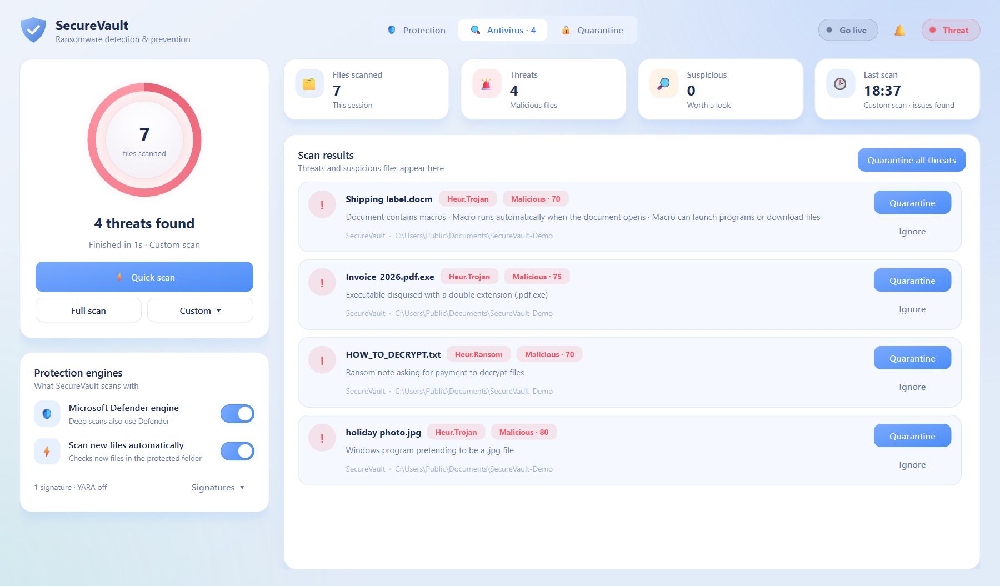
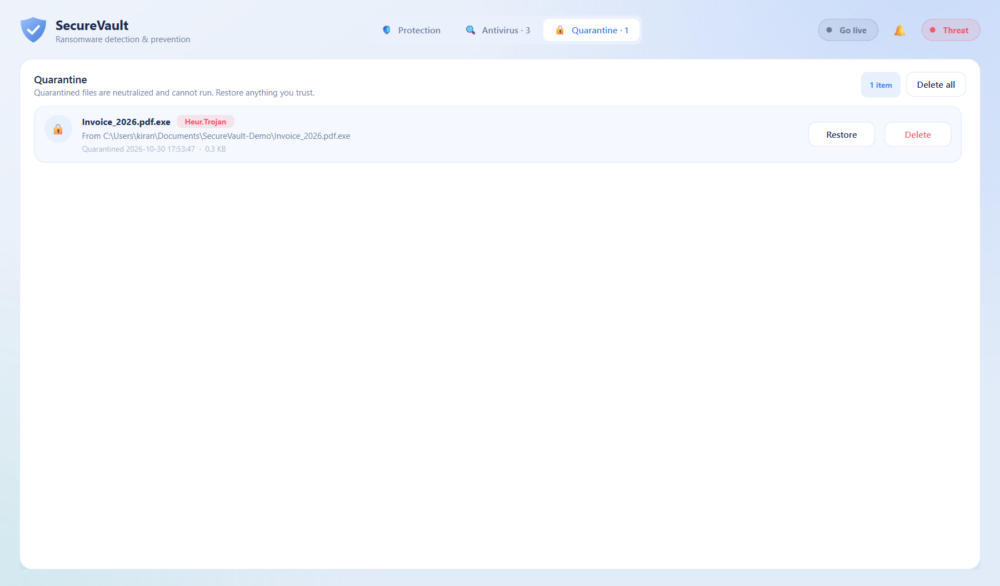
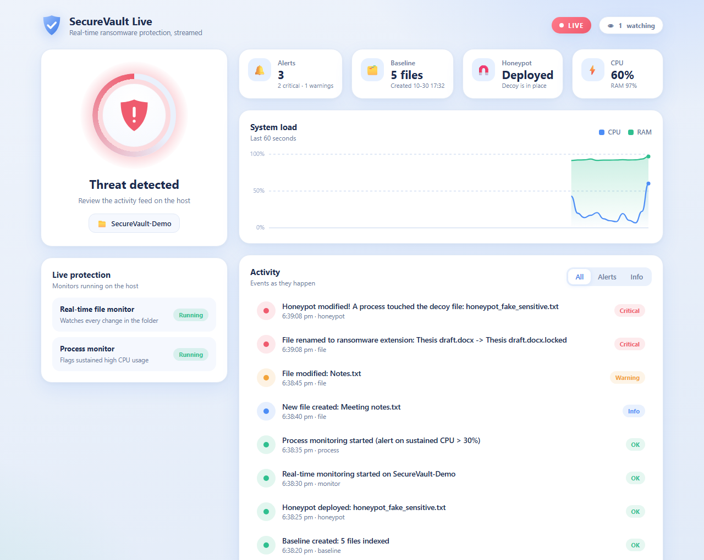
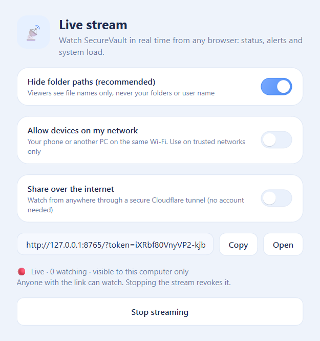
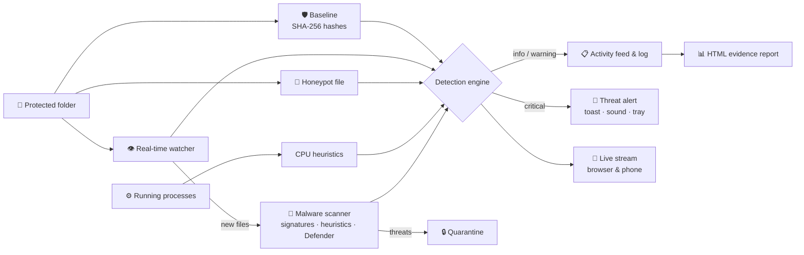

<div align="center">


# SecureVault

### Ransomware Detection & Prevention System

*Real-time file integrity monitoring, honeypot deception, a built-in malware scanner and behavioral heuristics:<br/>a free early warning system against ransomware for your most important folders.*

<br/>


[](https://github.com/kirangautham-82899/SecureVault-Ransomware-Detection-Prevention-System/releases/latest)

### [🌐 Website](https://kirangautham-82899.github.io/SecureVault-Ransomware-Detection-Prevention-System/) · [⬇️ Download for Windows](https://github.com/kirangautham-82899/SecureVault-Ransomware-Detection-Prevention-System/releases/latest/download/SecureVault-Windows.zip)

[**Features**](#-features) · [**Screenshots**](#-screenshots) · [**Antivirus**](#-antivirus) · [**Live Stream**](#-live-streaming) · [**Download**](#%EF%B8%8F-download) · [**Quick Start**](#-quick-start-from-source) · [**How It Works**](#-how-it-works) · [**Usage**](#-usage) · [**Project Structure**](#-project-structure)

<br/>


</div>

---

## 📖 Overview

Ransomware does its damage in minutes. It encrypts documents, renames them with strange extensions and leaves you a ransom note. **SecureVault** watches the folders you care about and raises the alarm the moment that pattern appears.

It takes a **known-good SHA-256 baseline** of your files, **watches every change in real time**, plants a **decoy honeypot file** that no legitimate program should ever touch, and keeps an eye on **processes burning CPU** the way encryption routines do. Everything shows up in a modern desktop dashboard, and every event can be exported as an evidence report.

It also includes an **antivirus scanner** with Quick, Full and Custom scans, on-access scanning of new files, and a quarantine. It can use **Microsoft Defender** as a second engine.

> [!NOTE]
> SecureVault **detects, alerts and quarantines**. It does not kill running processes or decrypt files. Pair it with regular offline backups.

---

## ✨ Features

<table>
<tr>
<td width="50%" valign="top">

### 🛡️ File Integrity Monitoring
SHA-256 baseline of every file in the protected folder. On-demand integrity scans report exactly which files were **modified**, **deleted** or **added**.

</td>
<td width="50%" valign="top">

### 👁️ Real-Time Watcher
Live file system events through `watchdog`: creations, modifications, deletions and **renames**, compared against the baseline as they happen.

</td>
</tr>
<tr>
<td valign="top">

### 🔒 Ransomware Heuristics
Critical alerts for files renamed to known ransomware extensions (`.locked`, `.encrypted`, `.wncry`, `.lockbit`, …) and for **bursts of mass file changes**.

</td>
<td valign="top">

### 🧲 Honeypot Deception
Drops a tempting decoy file into the protected folder. Any process that modifies, renames or deletes it triggers an **immediate critical alert**.

</td>
</tr>
<tr>
<td valign="top">

### ⚙️ Process Heuristics
Flags processes with **sustained high CPU usage**, normalized across all cores, with per-process cooldowns to keep the noise down.

</td>
<td valign="top">

### 📊 Evidence Reports
One click exports a self-contained **HTML report** of every event in the session, with timestamps, severity and file paths.

</td>
</tr>
<tr>
<td valign="top">

### 🦠 Antivirus Scanner
Quick, Full and Custom scans with **hash signatures, heuristics, optional YARA rules and Microsoft Defender**. Threats go to a **quarantine** where they can't run.

</td>
<td valign="top">

### ⚡ On-Access Scanning
While the real-time monitor runs, **every new or changed file** in the protected folder is scanned automatically, and threats raise a critical alert instantly.

</td>
</tr>
<tr>
<td valign="top">

### 📡 Live Streaming
Stream status, alerts and system load **in real time to any browser**, on this PC or your phone on the same Wi-Fi, through a private, read-only link.

</td>
<td valign="top">

### 🎨 Soft, Animated Design
A calm soft-blue interface with an animated protection ring, gliding toasts, counting stats and an activity feed where new events slide in.

</td>
</tr>
</table>

### 🖥️ A dashboard built for calm and clarity

- **Protection ring:** a comet orbits the shield while you're protected, rests when protection is off, and turns red and ripples outwards when a threat is detected
- **Four stat cards** (baseline, honeypot, alerts, CPU with a live sparkline) whose numbers count up smoothly
- **Action tiles** that lift and glow on hover and show a spinner while they work
- **Activity feed** where new events slide in and glow, with All / Alerts / Info filters and search
- **Gliding toast notifications**, animated toggle switches, a staggered entrance and an animated splash screen
- Optional sound alerts and **system tray** support so protection keeps running in the background

---

## 📸 Screenshots

<div align="center">

**Threat detected:** a simulated attack renames files to `.locked` and touches the honeypot


<br/><br/>

**Antivirus:** a custom scan catches a disguised `.pdf.exe`, a fake photo, an auto-running macro and a ransom note



<br/><br/>

**Quarantine:** neutralized files that can't run, with one-click restore or delete



<br/><br/>

**SecureVault Live:** the same protection, streamed to a browser in real time



<br/><br/>

<table>
<tr>
<td width="50%" align="center"><b>Go live in one click</b><br/><br/></td>
<td width="50%" align="center"><b>Activity log viewer</b><br/><br/></td>
</tr>
</table>

</div>

---

## 🦠 Antivirus

Open the **Antivirus** tab and pick a scan:

| Scan | What it checks |
| :--- | :--- |
| ⚡ **Quick scan** | Downloads, Desktop, Temp, the Startup folder and Public Downloads: where malware usually lands |
| **Full scan** | Everything in your user folder |
| **Custom** | Any folder or single file you choose |

Each finding shows **why** it was flagged, a verdict (*Malicious* or *Suspicious*) and a score. **Quarantine** moves the file into a neutralized vault where it cannot run, and the **Quarantine** tab lets you restore or permanently delete it. **Ignore** dismisses false positives.

### Detection engines

| Engine | What it catches | Status |
| :--- | :--- | :--- |
| **Hash signatures** | Exact known malware, by SHA-256. Import free lists such as the [MalwareBazaar](https://bazaar.abuse.ch/export/) hash exports via *Signatures ▸ Import* | Built in, extendable |
| **EICAR test file** | The standard harmless anti-virus test file | Built in |
| **Heuristics** | Double extensions (`invoice.pdf.exe`), programs disguised as photos or documents, right-to-left filename tricks, scripts that delete shadow copies / disable recovery / switch off Defender / run hidden encoded PowerShell, auto-running Office macros that launch programs, ransom notes, malicious shortcuts | Built in |
| **YARA rules** | Anything you write rules for; examples in `signatures/yara/` | Optional: `pip install yara-python` |
| **Microsoft Defender** | Millions of real-world threats via Defender's engine (`MpCmdRun.exe`), used during scans without letting it delete anything on its own | Automatic when Defender is installed |

**On-access scanning:** with *Scan new files automatically* on, every file created or changed in the protected folder is scanned while the real-time monitor runs.

**From the command line:**
```bash
python main.py --scan                          # quick scan
python main.py --scan "C:\Users\me\Downloads"  # scan a folder
python main.py --scan "D:\" --quarantine       # scan and quarantine malicious files
```

> [!IMPORTANT]
> **How does this compare to Avast or Bitdefender?** Honestly, it doesn't replace them. Commercial antivirus products use kernel drivers to block malware *before* it runs, plus cloud reputation, behavior blocking and signature databases with millions of entries maintained by full-time research teams. SecureVault scans files and alerts or quarantines; it doesn't block programs at the kernel level.
>
> The good news: **Windows already includes a free, top-rated antivirus, Microsoft Defender.** Keep it switched on. SecureVault adds ransomware-focused monitoring, a honeypot, its own heuristics and a friendly interface, and uses Defender as a second engine.

---

## 📡 Live Streaming

**SecureVault Live** streams the dashboard to any web browser in real time: the protection status, every alert as it happens, and a live CPU/RAM chart. Watch your PC from your phone while you're away from the desk, or keep the viewer on a second screen.

**From the dashboard**
1. Click **Go live** in the header.
2. Choose who can watch:
   - **Allow devices on my network**: your phone or another PC on the same Wi-Fi.
   - **Share over the internet**: anywhere in the world, through a secure [Cloudflare quick tunnel](https://developers.cloudflare.com/cloudflare-one/connections/connect-networks/do-more-with-tunnels/trycloudflare/). No account or router setup needed, just install Cloudflare's free tool once: `winget install Cloudflare.cloudflared`
3. Click **Start streaming**, then **Copy** or **Open** the private link (`https://….trycloudflare.com/?token=…` when shared over the internet).

The header badge shows `Live · N watching` while the stream runs.

**Without the GUI (headless)**
```bash
# Monitor a folder and stream it (this computer only)
python main.py --stream "C:\Users\me\Documents"

# Also allow devices on your network
python main.py --stream "C:\Users\me\Documents" --lan

# Share over the internet (Cloudflare tunnel)
python main.py --stream "C:\Users\me\Documents" --public
```
Headless mode runs the file and process monitors and prints the link. It's also option **8** in the CLI menu.

> [!IMPORTANT]
> **Privacy by design.** The viewer is **read-only**: nobody can change settings through it. Every request needs a **random access token**, and a new token is generated each time streaming starts, so stopping the stream revokes every link you've shared. The stream binds to `127.0.0.1` unless you explicitly allow your local network, and the internet tunnel only runs while you have it switched on.

**How it works:** a small built-in web server (Python standard library only) pushes updates over **Server-Sent Events**. Viewers reconnect automatically if the connection drops, and stalled viewers are disconnected so they never slow down detection. Through the internet tunnel, where live connections aren't reliable, the viewer switches to fetching updates every 2 seconds.

---

## ⬇️ Download

**[Download SecureVault for Windows](https://github.com/kirangautham-82899/SecureVault-Ransomware-Detection-Prevention-System/releases/latest/download/SecureVault-Windows.zip)** (Windows 10 & 11), or visit the **[website](https://kirangautham-82899.github.io/SecureVault-Ransomware-Detection-Prevention-System/)**.

1. Extract the zip anywhere, for example `Documents\SecureVault`.
2. Run **`SecureVault.exe`**. No installer, Python or admin rights needed.
3. If Windows SmartScreen says *"Windows protected your PC"*, click **More info → Run anyway**. It appears because the app isn't code-signed with a paid certificate.

Your settings, logs, baseline and quarantine are stored in `%LOCALAPPDATA%\SecureVault`.

---

## 🚀 Quick Start (from source)

**Requirements:** Python 3.8+ on Windows (the engine also runs on Linux/macOS; sound alerts are Windows-only).

```bash
# 1. Clone the repository
git clone https://github.com/kirangautham-82899/SecureVault-Ransomware-Detection-Prevention-System.git
cd SecureVault-Ransomware-Detection-Prevention-System

# 2. Install dependencies
pip install -r requirements.txt

# 3. Launch the dashboard
python main.py --gui
```

> [!TIP]
> Prefer the terminal? Run `python main.py` for the interactive command-line menu.

### Build the Windows app yourself
```bash
pip install -r requirements.txt pyinstaller
python packaging/build.py
```
This creates `dist/SecureVault/SecureVault.exe` and `dist/SecureVault-Windows.zip`.

### Releases and website
- **Releases are automated.** Pushing a version tag (`git tag v2.1.0 && git push origin v2.1.0`) runs [`.github/workflows/release.yml`](.github/workflows/release.yml) on GitHub's Windows servers: it runs the tests, builds the app, smoke-tests it and publishes `SecureVault-Windows.zip` as a GitHub Release.
- **Tests run on every push** via [`.github/workflows/tests.yml`](.github/workflows/tests.yml).
- **The website** is `docs/index.html`, served by GitHub Pages from the `docs/` folder of `main`. Its Download button always points at the latest release.

---

## 🔍 How It Works



### Detection rules

| Trigger | Severity | Why it matters |
| :--- | :---: | :--- |
| Honeypot file modified, renamed or deleted | 🔴 **Critical** | No legitimate program has a reason to touch the decoy |
| File renamed to a ransomware extension | 🔴 **Critical** | Classic sign of a file that has just been encrypted |
| More than 5 file changes within 10 seconds | 🔴 **Critical** | Ransomware encrypts files in rapid bursts |
| File content differs from baseline | 🟠 Warning | Possible unauthorized modification |
| File deleted | 🟠 Warning | Some ransomware deletes originals after encrypting copies |
| Process above 30% total CPU, 3 times in 30 s | 🟠 Warning | Bulk encryption is CPU-intensive |
| New file is malware (on-access scan) | 🔴 **Critical** | Caught the moment it lands in the folder |
| New file created | 🔵 Info | Tracked and hashed so later changes are detected |

Noise such as temporary files, logs, `.git`, `node_modules` and `__pycache__` is ignored automatically.

---

## 🛠️ Usage

### GUI dashboard

| Step | Action | What it does |
| :---: | :--- | :--- |
| 1 | **Folder chip** under the ring | Pick the folder to protect (defaults to your home folder) |
| 2 | **Create baseline** | Hashes every file to record its known-good state |
| 3 | **Deploy honeypot** | Places the decoy file inside the protected folder |
| 4 | **Live protection** switches | Turns on the real-time file monitor and the process monitor |
| 5 | **Integrity scan** | Compares the folder against the baseline at any time |
| 6 | **Go live** *(optional)* | Streams the dashboard to a browser |

- **Acknowledge** a threat by clicking the shield or the red status badge.
- **Export an evidence report** (HTML) from the `⋯` menu on the Activity card. Double-click an event to open its folder.
- **Closing the window** while a monitor or the live stream is running keeps SecureVault protecting from the system tray. Right-click the tray icon to quit.

### Command-line menu

```text
===== SecureVault v2.1.0: Ransomware Detection System =====
1. Create Baseline Hashes
2. Check for Changes (Manual Scan)
3. Create Honeypot File
4. Start Real-Time File Monitoring
5. Start Suspicious Process Monitoring (CPU)
6. Launch GUI Dashboard
7. Change Folder
8. Live Stream to Browser (headless)
9. Antivirus Scan (quick scan, or a folder)
0. Exit
```

The CLI starts on the current directory. Press <kbd>Ctrl</kbd> + <kbd>C</kbd> to stop a running monitor or stream.

Shortcuts: `python main.py --gui` opens the dashboard, `python main.py --scan [path] [--quarantine]` runs an antivirus scan, and `python main.py --stream [folder] [--lan]` starts a headless live stream.

### Using the engine from Python

```python
from main import create_baseline, check_for_changes, create_honeypot

create_baseline(r"C:\Users\me\Documents")
create_honeypot(r"C:\Users\me\Documents")
result = check_for_changes(r"C:\Users\me\Documents")
print(result["modified"], result["deleted"], result["new"])
```

Every engine function accepts an optional `sink`: a callable or a `queue.Queue` that receives structured `Event` objects (`level`, `message`, `category`, `path`, `timestamp`).

---

## 📂 Project Structure

```text
SecureVault/
├── main.py              # Detection engine + CLI entry point
├── scanner.py           # Antivirus engine, on-access scanning and quarantine
├── stream.py            # Live streaming server (Server-Sent Events)
├── signatures/
│   ├── hashes.txt       # SHA-256 signature list (import more from the app)
│   └── yara/            # Optional YARA rules
├── web/
│   └── index.html       # Live web viewer (responsive, works on phones)
├── gui/
│   ├── main_gui.py      # Dashboard window, log viewer, report export
│   ├── antivirus.py     # Antivirus and Quarantine pages
│   ├── widgets.py       # Animated widgets: protection ring, tiles, toasts, feed, switches
│   ├── theme.py         # Soft-blue palette and application stylesheet
│   └── splash.py        # Startup splash screen
├── tests/
│   ├── test_main.py     # Engine unit tests
│   ├── test_scanner.py  # Antivirus engine and quarantine tests
│   └── test_stream.py   # Live stream tests
├── packaging/
│   ├── build.py         # Builds SecureVault.exe and the release zip (PyInstaller)
│   └── launcher.py      # Entry point of the packaged app
├── docs/                # Website (GitHub Pages), logo and screenshots
├── .github/workflows/   # Tests on every push; release builds on version tags
└── requirements.txt
```

Runtime files are created next to `main.py` and are git-ignored:

| File | Contents |
| :--- | :--- |
| `hash_db.json` | Baseline database: protected folder, creation time and file hashes |
| `suspicious_activity.log` | Timestamped log of every event |
| `quarantine/` | Neutralized quarantined files and their details |
| `signatures/user_hashes.txt` | Hash signatures you imported |

---

## 🧪 Running Tests

```bash
python -m pytest tests
```

The suite covers exclusions, hashing, baseline creation, integrity scans, honeypot alerts, ransomware-extension renames, mass-change detection, the antivirus engine (EICAR, signatures, every heuristic, Defender output parsing, quarantine round-trips, on-access scanning) and the live stream: token checks, live event delivery and link revocation.

---

## 🧰 Tech Stack

| Component | Technology |
| :--- | :--- |
| Language | Python 3 |
| GUI | PyQt6 (custom-painted, animated widgets) |
| Live streaming | `http.server` + Server-Sent Events, vanilla HTML/CSS/JS, Cloudflare quick tunnels |
| Packaging & deployment | PyInstaller, GitHub Actions, GitHub Releases, GitHub Pages |
| File monitoring | [watchdog](https://github.com/gorakhargosh/watchdog) |
| Process metrics | [psutil](https://github.com/giampaolo/psutil) |
| Hashing | SHA-256 (`hashlib`) |
| Malware scanning | Own heuristics + optional [YARA](https://virustotal.github.io/yara/) + Microsoft Defender (`MpCmdRun.exe`) |

---

## ⚠️ Disclaimer

**SecureVault is a proof-of-concept security tool** built for learning and to add an extra layer to your defenses. It is **not** a replacement for enterprise-grade antivirus or anti-ransomware products. Always keep **offline backups** of important data.

---

<div align="center">

Made with 🛡️ by **Kiran Gautham**

If you find this project useful, consider giving it a ⭐

</div>
