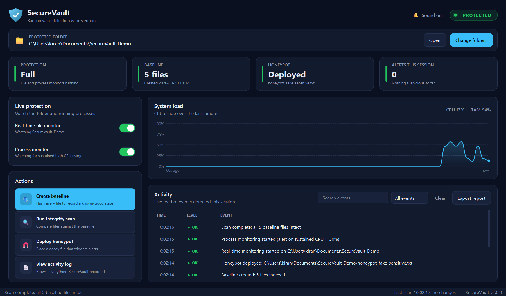
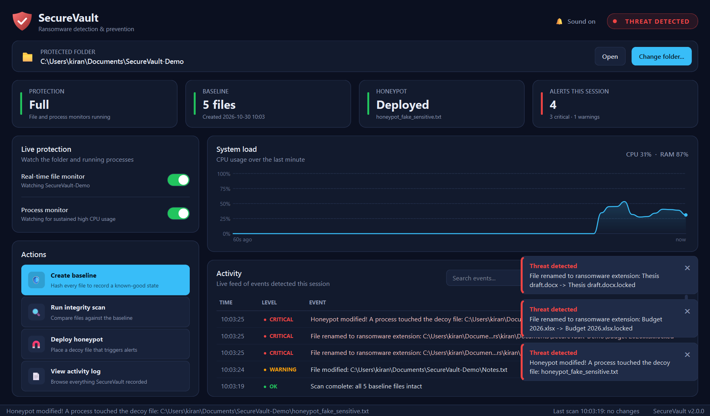
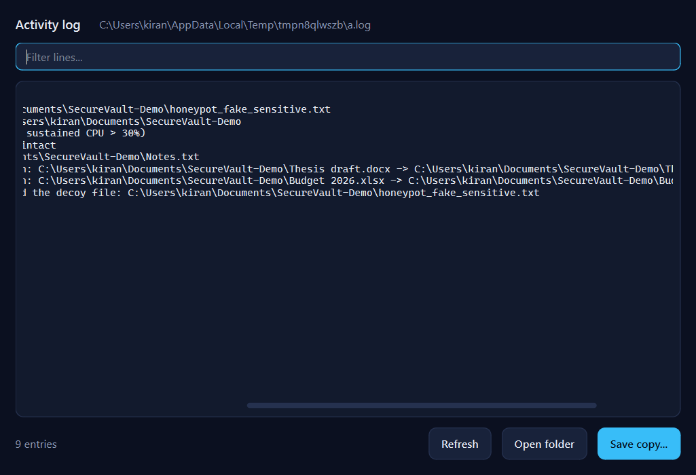
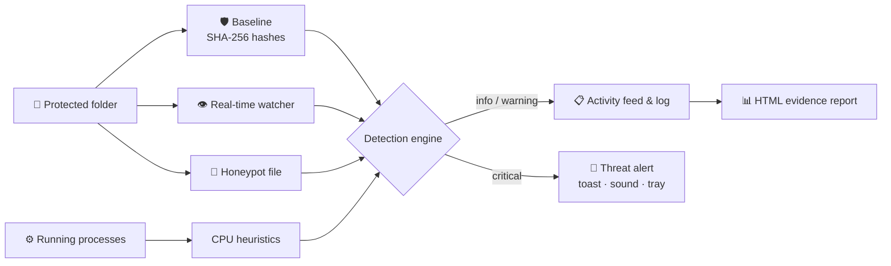

<div align="center">


# SecureVault

### Ransomware Detection & Prevention System

*Real-time file integrity monitoring, honeypot deception and behavioral heuristics:<br/>an early warning system against ransomware for your most important folders.*

<br/>


[**Features**](#-features) · [**Screenshots**](#-screenshots) · [**Quick Start**](#-quick-start) · [**How It Works**](#-how-it-works) · [**Usage**](#-usage) · [**Project Structure**](#-project-structure)

<br/>



</div>

---

## 📖 Overview

Ransomware does its damage in minutes. It encrypts documents, renames them with strange extensions and leaves you a ransom note. **SecureVault** watches the folders you care about and raises the alarm the moment that pattern appears.

It takes a **known-good SHA-256 baseline** of your files, **watches every change in real time**, plants a **decoy honeypot file** that no legitimate program should ever touch, and keeps an eye on **processes burning CPU** the way encryption routines do. Everything shows up in a modern desktop dashboard, and every event can be exported as an evidence report.

> [!NOTE]
> SecureVault **detects and alerts**. It does not kill processes or restore files. Pair it with regular offline backups.

---

## ✨ Features

<table>
<tr>
<td width="50%" valign="top">

### 🛡️ File Integrity Monitoring
SHA-256 baseline of every file in the protected folder. On-demand integrity scans report exactly which files were **modified**, **deleted** or **added**.

</td>
<td width="50%" valign="top">

### 👁️ Real-Time Watcher
Live file system events through `watchdog`: creations, modifications, deletions and **renames**, compared against the baseline as they happen.

</td>
</tr>
<tr>
<td valign="top">

### 🔒 Ransomware Heuristics
Critical alerts for files renamed to known ransomware extensions (`.locked`, `.encrypted`, `.wncry`, `.lockbit`, …) and for **bursts of mass file changes**.

</td>
<td valign="top">

### 🧲 Honeypot Deception
Drops a tempting decoy file into the protected folder. Any process that modifies, renames or deletes it triggers an **immediate critical alert**.

</td>
</tr>
<tr>
<td valign="top">

### ⚙️ Process Heuristics
Flags processes with **sustained high CPU usage**, normalized across all cores, with per-process cooldowns to keep the noise down.

</td>
<td valign="top">

### 📊 Evidence Reports
One click exports a self-contained **HTML report** of every event in the session, with timestamps, severity and file paths.

</td>
</tr>
</table>

### 🖥️ A dashboard built for clarity

- **At-a-glance status:** a header badge switches between `PROTECTED`, `UNPROTECTED` and a pulsing `THREAT DETECTED`
- **Stat cards** for protection, baseline, honeypot and session alerts
- **Toggle switches** to start and stop each monitor instantly
- **Live CPU graph** with hover read-outs, plus RAM usage
- **Searchable activity feed**, filterable by severity. Double-click an event to open its folder
- **Toast notifications**, optional sound alerts and **system tray** support so protection keeps running in the background

---

## 📸 Screenshots

<div align="center">

**Threat detected:** a simulated attack renames files to `.locked` and touches the honeypot



<br/><br/>

**Activity log viewer:** everything SecureVault has recorded, searchable and exportable



</div>

---

## 🚀 Quick Start

**Requirements:** Python 3.8+ on Windows (the engine also runs on Linux/macOS; sound alerts are Windows-only).

```bash
# 1. Clone the repository
git clone https://github.com/kirangautham-82899/SecureVault-Ransomware-Detection-Prevention-System.git
cd SecureVault-Ransomware-Detection-Prevention-System

# 2. Install dependencies
pip install -r requirements.txt

# 3. Launch the dashboard
python main.py --gui
```

> [!TIP]
> Prefer the terminal? Run `python main.py` for the interactive command-line menu.

---

## 🔍 How It Works



### Detection rules

| Trigger | Severity | Why it matters |
| :--- | :---: | :--- |
| Honeypot file modified, renamed or deleted | 🔴 **Critical** | No legitimate program has a reason to touch the decoy |
| File renamed to a ransomware extension | 🔴 **Critical** | Classic sign of a file that has just been encrypted |
| More than 5 file changes within 10 seconds | 🔴 **Critical** | Ransomware encrypts files in rapid bursts |
| File content differs from baseline | 🟠 Warning | Possible unauthorized modification |
| File deleted | 🟠 Warning | Some ransomware deletes originals after encrypting copies |
| Process above 30% total CPU, 3 times in 30 s | 🟠 Warning | Bulk encryption is CPU-intensive |
| New file created | 🔵 Info | Tracked and hashed so later changes are detected |

Noise such as temporary files, logs, `.git`, `node_modules` and `__pycache__` is ignored automatically.

---

## 🛠️ Usage

### GUI dashboard

| Step | Action | What it does |
| :---: | :--- | :--- |
| 1 | **Change folder…** | Pick the folder to protect (defaults to your home folder) |
| 2 | **Create baseline** | Hashes every file to record its known-good state |
| 3 | **Deploy honeypot** | Places the decoy file inside the protected folder |
| 4 | **Live protection** switches | Turns on the real-time file monitor and the process monitor |
| 5 | **Run integrity scan** | Compares the folder against the baseline at any time |

- **Acknowledge** a threat by clicking the red status badge.
- **Export report** saves an HTML evidence report and opens it.
- **Closing the window** while a monitor is running keeps SecureVault protecting from the system tray. Right-click the tray icon to quit.

### Command-line menu

```text
===== SecureVault v2.0.0: Ransomware Detection System =====
1. Create Baseline Hashes
2. Check for Changes (Manual Scan)
3. Create Honeypot File
4. Start Real-Time File Monitoring
5. Start Suspicious Process Monitoring (CPU)
6. Launch GUI Dashboard
7. Change Folder
0. Exit
```

The CLI starts on the current directory. Press <kbd>Ctrl</kbd> + <kbd>C</kbd> to stop a running monitor.

### Using the engine from Python

```python
from main import create_baseline, check_for_changes, create_honeypot

create_baseline(r"C:\Users\me\Documents")
create_honeypot(r"C:\Users\me\Documents")
result = check_for_changes(r"C:\Users\me\Documents")
print(result["modified"], result["deleted"], result["new"])
```

Every engine function accepts an optional `sink`: a callable or a `queue.Queue` that receives structured `Event` objects (`level`, `message`, `category`, `path`, `timestamp`).

---

## 📂 Project Structure

```text
SecureVault/
├── main.py              # Detection engine + CLI entry point
├── gui/
│   ├── main_gui.py      # Dashboard window, log viewer, report export
│   ├── widgets.py       # Toggle switch, stat cards, CPU graph, toasts, icons
│   ├── theme.py         # Colour palette and application stylesheet
│   └── splash.py        # Startup splash screen
├── tests/
│   └── test_main.py     # Engine unit tests
├── docs/                # Logo and screenshots
└── requirements.txt
```

Runtime files are created next to `main.py` and are git-ignored:

| File | Contents |
| :--- | :--- |
| `hash_db.json` | Baseline database: protected folder, creation time and file hashes |
| `suspicious_activity.log` | Timestamped log of every event |

---

## 🧪 Running Tests

```bash
python -m pytest tests
```

The suite covers exclusions, hashing, baseline creation, integrity scans, honeypot alerts, ransomware-extension renames and mass-change detection.

---

## 🧰 Tech Stack

| Component | Technology |
| :--- | :--- |
| Language | Python 3 |
| GUI | PyQt6 (custom-painted widgets, Fusion style) |
| File monitoring | [watchdog](https://github.com/gorakhargosh/watchdog) |
| Process metrics | [psutil](https://github.com/giampaolo/psutil) |
| Hashing | SHA-256 (`hashlib`) |

---

## ⚠️ Disclaimer

**SecureVault is a proof-of-concept security tool** built for learning and to add an extra layer to your defenses. It is **not** a replacement for enterprise-grade antivirus or anti-ransomware products. Always keep **offline backups** of important data.

---

<div align="center">

Made with 🛡️ by **Kiran Gautham**

If you find this project useful, consider giving it a ⭐

</div>
